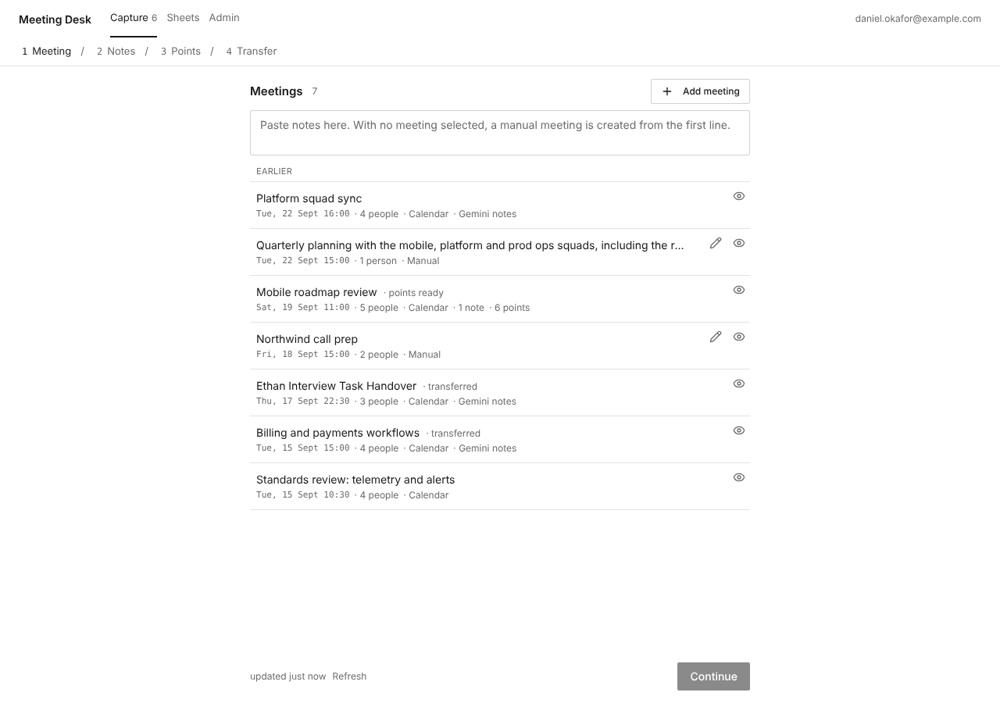
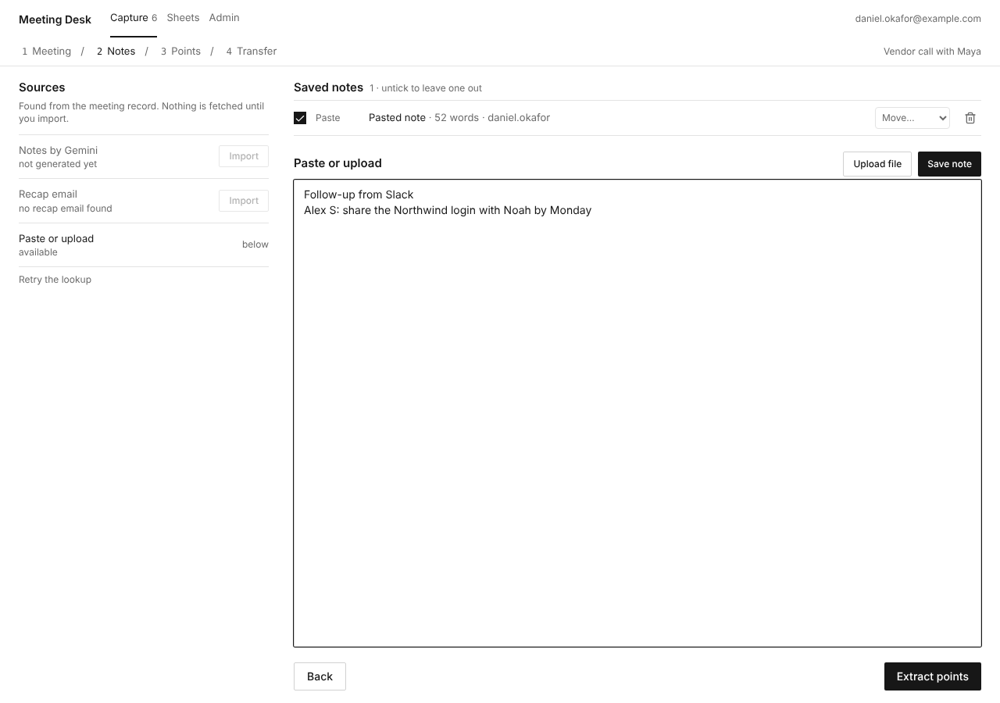
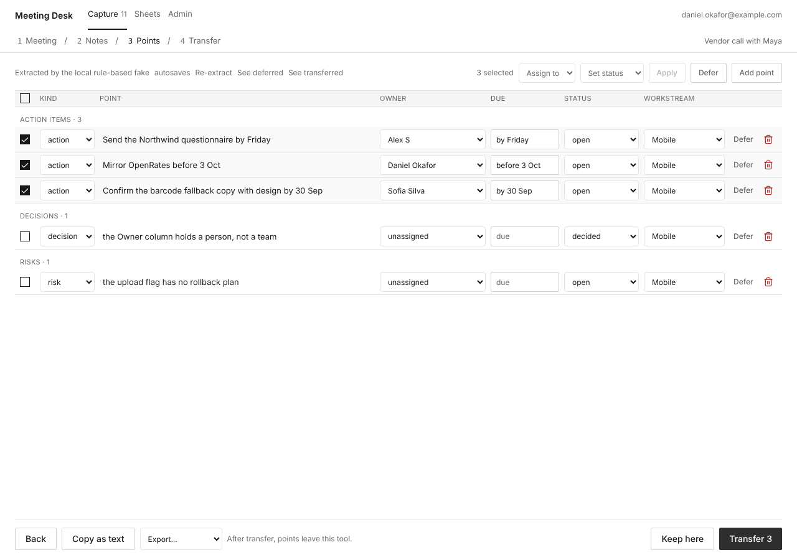
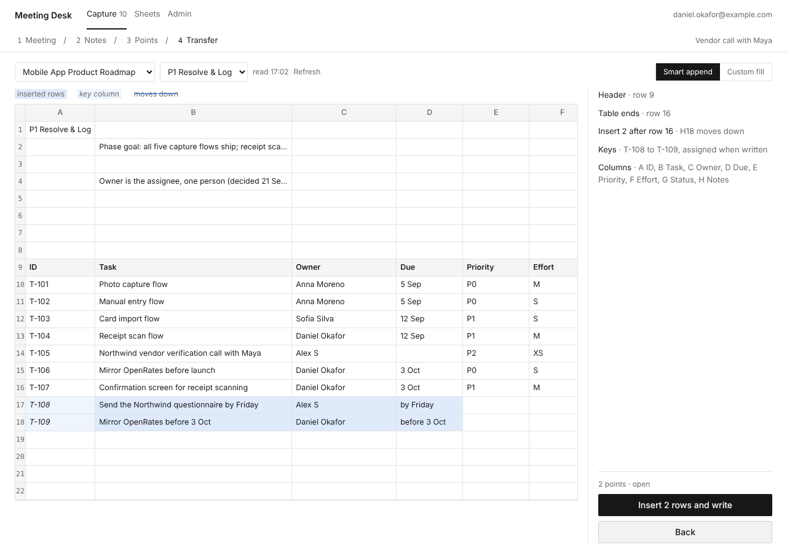
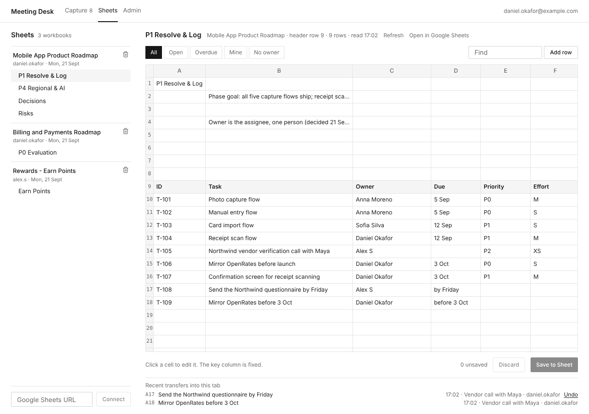
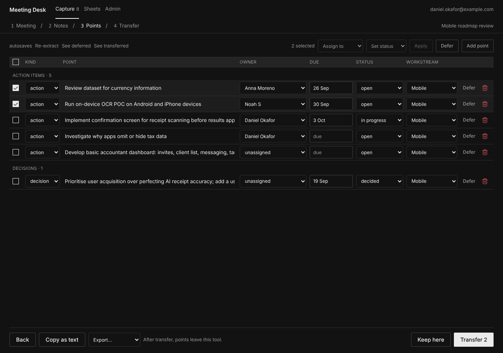
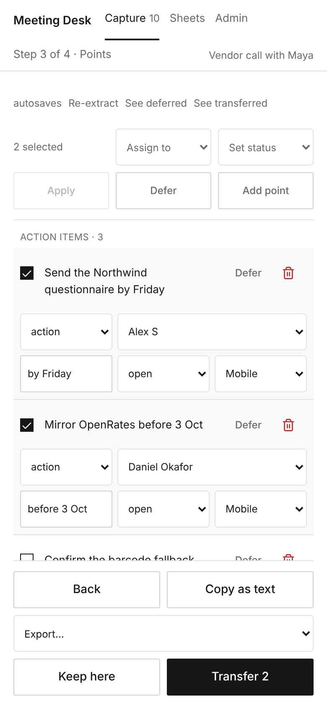

<div align="center">


# Meeting Desk

**Turn meeting notes into action items, and write them straight into your Google Sheet.**

[](LICENSE)


</div>

Meeting Desk is a self-hosted, open-source web app for teams that run their roadmap in Google
Sheets. It takes the notes from a meeting (a Google Meet "Notes by Gemini" doc, the recap email,
a transcript file, or anything you paste) and uses AI to pull out the **action items, owners, due
dates, decisions, risks and open questions**. You review and edit them. Then it writes them as rows
into the right tab of your existing spreadsheet, keeping its layout, keys, formulas and dropdowns
intact.

Use Gemini, Claude, OpenAI or any OpenAI-compatible model. A **local model through Ollama** works
too, so your notes never leave your machine.

<p align="center">
  
</p>

## Features

- **Meetings from Google Calendar.** Recent and upcoming events from every connected account, merged
  and de-duplicated, or add a meeting by hand.
- **Notes from wherever they are.** It finds the meeting's *Notes by Gemini* doc (including the
  transcript tab) and the Gemini recap email. You can also paste text, or upload a **.txt, .md,
  .vtt or .srt** transcript from Google Meet, Zoom or Microsoft Teams.
- **AI extraction you can trust.** Action items, decisions, risks and questions come back in one
  strict JSON schema. Owners are matched to attendees and your directory, and "by Friday" becomes a
  date, both by code rather than by the model. When two people in the room have near-identical
  names, it flags the point for you instead of guessing.
- **A review step.** Edit, bulk-assign, defer or remove points before anything is written. Every
  change autosaves.
- **Safe writes to Google Sheets.** It finds the header row and the end of the table on its own and
  previews exactly where the rows will land before writing.
  - Writes are a single batch.
  - Key IDs (T-108, T-109, ...) are generated and formula columns are copied down.
  - Date columns get real dates.
  - If someone edited the sheet in the meantime, nothing is overwritten.
  - **Undo** works for 10 minutes after a write.
- **Edit the sheet in place.** Browse and filter any connected tab, edit cells with the sheet's own
  dropdown values, and add rows above any row.
- **Export anywhere else.** Copy as text, or download as **Markdown** or **CSV** for a doc, an
  issue tracker or another spreadsheet. **GitHub Issues-ready Markdown** gives each action item
  its own title, owner, due date and meeting context, ready to paste into a new issue.
- **Tell the team.** Each transfer can post a summary to **Slack**, **Google Chat**, Mattermost or
  Discord through an incoming webhook (`NOTIFY_WEBHOOK_URL`).
- **Works with a personal Google account.** `GOOGLE_USE_GMAIL=0` and `GOOGLE_USE_DIRECTORY=0` leave
  out the Workspace-only and restricted scopes.
- **Built for a team.** Google sign-in, an allow-list with admin and member roles, and an activity
  log of every change. Optionally limited to your Google Workspace domain.
- **Production-ready.** It ships as one Docker image, with a Helm chart, Postgres, a background
  worker, Prometheus metrics and alert rules, and structured logs. About 800 tests run with no
  network access.
- **Dark mode and a phone layout.**

## Try it in one minute (no account, no API key)

The demo runs the whole app against a built-in fake Google workspace: a calendar, Gemini notes and
three roadmap spreadsheets, with a rule-based extractor. Nothing leaves your machine.

**With Docker:**

```bash
git clone https://github.com/Prathyush-KKK/meeting-desk.git
cd meeting-desk
docker compose -f docker-compose.demo.yml up
```

Open **http://localhost:8000**. You are signed in as the demo team's admin. The first run builds
the image, which takes a few minutes.

**Without Docker** (Python 3.12 and Node 22 with pnpm):

```bash
make install web-install   # once
make run                   # the API on :8000, with the fake Google
make web-dev               # in a second terminal: the app on http://localhost:5173
```

Then try it:

1. Paste the snippet below into the box at the top of **Capture**.
2. **Extract points**.
3. Tick the points to send, **Transfer**, and watch the rows land in *Mobile App Product
   Roadmap → P1 Resolve & Log*.

```text
Vendor call with Maya

The Next Steps
Alex S: Send the Northwind questionnaire by Friday
Daniel Okafor: Mirror OpenRates before 3 Oct
Decided: the Owner column holds a person, not a team
Risk: the upload flag has no rollback plan
```

## How it works

| 1. Pick a meeting | 2. Gather the notes |
| --- | --- |
|  |  |
| **3. Review the points** | **4. Preview and write** |
|  |  |

Afterwards, the **Sheets** page shows the tab with the new rows, ready for edits:

<p align="center"></p>

It follows your system's dark mode, and the whole flow works on a phone:

<p align="center">
  
  
</p>

## Use it with your own Google account

1. Create a Google OAuth client. [docs/GOOGLE_SETUP.md](docs/GOOGLE_SETUP.md) covers it step by step,
   for both Google Workspace and personal accounts.
2. Copy `.env.live.example` to `.env` and fill in your email and the two OAuth values.
3. Run `scripts/live.sh`. It generates the secrets, starts Postgres and the app on
   http://localhost:8000, and waits until it is healthy.
4. Sign in. On **Admin → Connect an account**, connect the Google account whose calendar and notes
   you want to use.
5. On **Sheets**, paste the URL of your roadmap spreadsheet.

## Choose your AI model

Set `FAKE_LLM=0` and pick a provider. All of them get the same prompt and must return the same
schema.

| Provider | Settings |
| --- | --- |
| **OpenAI** | `EXTRACTION_PROVIDER=openai` `LLM_API_KEY=sk-...` `LLM_MODEL=gpt-4.1-mini` |
| **Ollama** (local, private) | `EXTRACTION_PROVIDER=openai` `LLM_BASE_URL=http://localhost:11434/v1` `LLM_MODEL=llama3.1` |
| **OpenRouter, LM Studio, vLLM, Groq, ...** | `EXTRACTION_PROVIDER=openai` plus that endpoint's `LLM_BASE_URL`, key and model |
| **Claude** (Anthropic API) | `EXTRACTION_PROVIDER=anthropic` `ANTHROPIC_API_KEY=sk-ant-...` |
| **Gemini** (Vertex AI) | `EXTRACTION_PROVIDER=vertex` `VERTEX_PROJECT=...` |
| **Amazon Bedrock** | `EXTRACTION_PROVIDER=bedrock` plus a Bedrock API key or AWS credentials |

Every setting is listed in [docs/CONFIGURATION.md](docs/CONFIGURATION.md).

## Deploy

- **One container:** `deploy/Dockerfile.api` builds one image that serves the API and the web app.
  Give it Postgres and your settings.
- **Kubernetes:** the Helm chart in `deploy/helm/meeting-desk` includes the API, the worker, the
  migration job, External Secrets, a ServiceMonitor and Prometheus alert rules.

See [docs/DEPLOY.md](docs/DEPLOY.md).

## Documentation

| | |
| --- | --- |
| [GOOGLE_SETUP.md](docs/GOOGLE_SETUP.md) | The OAuth client, consent screen, scopes, and running with your account |
| [CONFIGURATION.md](docs/CONFIGURATION.md) | Every environment variable, the LLM providers, the background jobs |
| [DEPLOY.md](docs/DEPLOY.md) | The Docker image, the Helm chart, secrets, key rotation |
| [DEVELOPMENT.md](docs/DEVELOPMENT.md) | Code layout, the demo world, tests, the API walkthrough |
| [TELEMETRY.md](docs/TELEMETRY.md) | Metrics, logs, alerts and how to check them |
| [web/README.md](web/README.md) | The web app, its tests and the browser walkthrough |

## Tech stack

FastAPI, SQLAlchemy and Alembic on Postgres (SQLite for development), with procrastinate for
background jobs. The Google APIs are called over plain HTTP with httpx. The web app is React 19,
TypeScript, Vite, Tailwind, shadcn/ui and TanStack Query. Packaged as Docker and Helm, with
Prometheus metrics.

## Roadmap

These are ideas, and contributions are welcome:

- More export targets: Linear, Jira, Notion. The GitHub Issues Markdown export is local; it does not create issues or connect to GitHub.
- More note sources: Zoom and Microsoft Teams cloud transcripts, Otter, Fireflies.
- Per-user calendars and personal workspaces.
- Notes and extraction in languages other than English.

Open an [issue](https://github.com/Prathyush-KKK/meeting-desk/issues) to discuss one before you
start.

## Contributing

Read [CONTRIBUTING.md](CONTRIBUTING.md). `make check` runs the linters and both test suites, and no
credentials are needed. Please report security issues privately, as described in
[SECURITY.md](SECURITY.md).

## License

[MIT](LICENSE)
